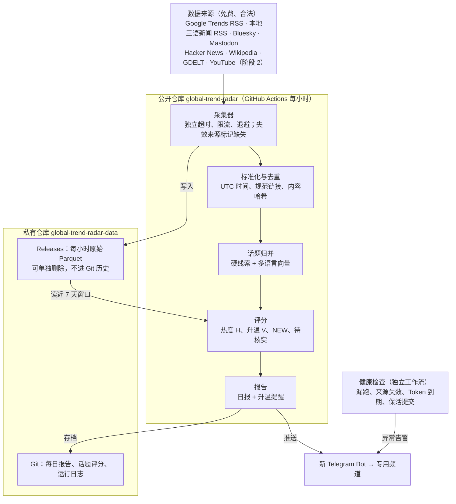

# Global Trend Radar：独立调查与实施方案

核查日期：2026-11-25 · 作者：Claude · 状态：待三方讨论，未获实施授权

本文件是 Claude 对前一版方案（ChatGPT，2026-10-31 讨论）的独立复核与改进方案。所有价格、条款、额度以核查当日为准，实施前仍需复核。

---

## 1. 结论摘要

推荐自建一套轻量 Python 采集器：代码放在公开仓库，用免费的 GitHub Actions 每小时运行；数据存进另一个私有仓库；结果推送到新建的独立 Telegram Bot。不直接部署 TrendRadar。

与前一版方案相比，有五处关键不同：

- **来源已经变了**：Reddit 已停止受理新的 API 申请，RSS 也已关闭；YouTube 的 mostPopular 只剩音乐、电影、游戏；X 改为按次付费；GitHub Models 已下线。这四项都要从免费方案里拿掉或降级。
- **TrendRadar 不适合当底座**：它的热榜数据来自第三方 newsnow 接口，主要覆盖中国平台；用 GitHub Actions 部署要每 7 天签到一次，保存历史还要绑卡开通 R2。
- **与其他项目隔离要更彻底**：如果新项目用私有仓库跑 Actions，会和 Owner 其他私有仓库共用每月约 2,000 分钟的免费额度。额度用完后所有私有仓库的 Actions 都会被暂停。公开仓库的标准 runner 免费，可以避开这个风险。
- **补上前一版漏掉的免费来源**：Bluesky 趋势、Mastodon 趋势、Wikipedia 浏览量、GDELT 全球新闻库。另外，Google Trends RSS 每条都附带新闻链接，可以直接把搜索热词和新闻事件对上。
- **跨语言归并用多语言向量模型**：中文、英文、马来语的同一事件，用免费的 CPU 模型归并，比只比较标题相似度可靠。

**零费用怎么保证**：所有组件都在免费额度内，不绑新卡，不开云存储计费。上线前还会核对 Owner GitHub 账号的计费设置。

**必须先说清的限制**：TikTok、Facebook、Instagram、X 的数据在免费、合法的前提下都拿不到。马来西亚社交媒体上的爆红，只能通过 Google 搜索飙升、YouTube 榜单、新闻扩散速度这些间接信号来捕捉。每份报告都会写明实际覆盖了哪些来源。

---

## 2. 真正需求，以及前一版方案的不足

Owner 要的不是新闻聚合器，而是一个 “早期预警雷达”：比大部分人更早看到马来西亚和全球正在升温的话题，并且能拿今天和昨天、上周比较。所以系统的核心是三件事：稳定的定时采集、可追溯的历史数据、能解释的升温算法。摘要好不好看是次要的。

前一版的框架方向是对的：独立仓库、先核实来源、分阶段验收、不碰其他项目。问题在于它的来源和费用信息停在 10 月 31 日，而且有几个关键风险没有展开。

| 问题 | 前一版的判断 | 2026-11-25 核实结果 | 影响 |
| --- | --- | --- | --- |
| Reddit | 后续有条件启用 | 10 月 31 日起停止受理新的 API 申请，11 月 13 日关闭 RSS，2027 年 3 月关闭剩余公开 API（[TechRepublic](https://www.techrepublic.com/article/news-reddit-rss-public-api-shutdown/)） | 移出方案 |
| YouTube | 用 mostPopular 当全站热榜 | 从 2025 年 7 月 21 日起，mostPopular 不再对应 Trending，只含音乐、电影、游戏（[YouTube API 变更记录](https://developers.google.com/youtube/v3/revision_history)） | 降为娱乐类信号 |
| TrendRadar | 首选研究对象 | 热榜依赖第三方 newsnow API；Actions 部署每 7 天要签到；历史需要 S3/R2（[README](https://github.com/sansan0/TrendRadar)） | 不当底座 |
| 私有 Actions 额度 | 估算 744–1,488 分钟 | Free 计划每月含 US$12 计算额度，没有付款方式时用完即暂停（[GitHub 计费](https://docs.github.com/billing/managing-billing-for-your-products/managing-billing-for-github-actions)） | 可能拖垮其他项目的 Actions |
| 公开仓库定时任务 | 只提到会延迟 | 仓库 60 天没有活动，定时任务会被自动停用；高峰时可能延迟甚至丢弃 | 要设计保活和漏跑告警 |
| Actions 使用条款 | 未提 | 禁止 “与仓库软件项目无关” 或 “造成不成比例负荷” 的用法（[GitHub 条款](https://docs.github.com/en/site-policy/github-terms/github-terms-for-additional-products-and-features)） | 每次运行要短、频率要克制 |
| X / Twitter | 付费接口待复核 | 已全面改为按次付费，Trends 每次 US$0.010（[X 官方价格](https://docs.x.com/x-api/getting-started/pricing)） | 只能作为付费选项 |
| 免费 AI | 后续增强 | GitHub Models 已于 2026-07-30 全面下线（[GitHub Changelog](https://github.blog/changelog/2026-07-30-github-models-is-now-retired/)） | MVP 不依赖 LLM |
| 跨语言归并 | 规范 URL + 标题相似度 | 中英马三语标题字面几乎不重合 | 改用多语言向量模型 |
| 数据存放 | 数据分支保存 JSONL/CSV | 公开仓库等于公开转发采集内容；Git 历史难删、会膨胀 | 原始数据放私有仓库 Releases |

另外，前一版把 “新闻” 和 “社交媒体爆红” 当成同一类问题处理。实际上社交平台的免费数据几乎全部关闭，必须改用 “间接信号 + 覆盖度标注” 的方法，见第 7 节。

---

## 3. 开源项目调查

没有一个现成开源项目能同时满足 “全球 + 马来西亚、升温检测、历史对比、零费用、长期稳定”。最佳做法是只借用成熟的库，自己写一层很薄的业务代码（估计 1,500–2,500 行）。这样比改造一个大项目更省力，也更稳定。

### TrendRadar：参考设计，不部署，不复制代码

最新版 v6.11.0（2026-10-13），GPL-3.0 许可，约 6.3 万 star（[GitHub](https://github.com/sansan0/TrendRadar)）。它做得很成熟，但与本项目的需求有四处根本冲突：

1. 热榜数据来自 newsnow 项目的公开 API。README 自己也说，这依赖对方的善意，并请用户不要过度请求。这属于未获授权的单点依赖。
2. 默认平台是知乎、抖音、微博等中国平台，海外内容只能靠 RSS。马来西亚覆盖要全部重做。
3. 用 GitHub Actions 部署时，服务有 7 天有效期，没有触发签到工作流就会自动暂停。它的仓库内存储功能也曾因给 GitHub 服务器带来过高负载而取消。
4. 不配远程存储就没有历史记录；配的话要用 S3 兼容存储，示例是需要绑定付款方式的 Cloudflare R2。

值得借鉴的是它的设计思路：关键词分组、新鲜度过滤、长消息分批推送、“新增/持续” 标记。我们只参考思路自己实现，不复制 GPL 代码，许可义务问题也就不存在。

### 其他候选项目

| 项目 | 结论 | 理由 |
| --- | --- | --- |
| NewsNow | 不用 | 中文热榜展示工具，来源偏中国；自建需要服务器。中文热榜可作阶段 4 选项 |
| RSSHub | 不自建 | 需要常驻服务器；大部分马来西亚媒体本来就有官方 RSS，用不上 |
| MediaCrawler | 不用 | 要登录、要绕风控，违反平台条款的风险高 |
| BettaFish | 暂不用 | 多 Agent 舆情分析，依赖付费大模型，适合以后做深度分析 |

以上四项沿用前一版报告的判断，这次没有逐一重新核查它们的仓库。

### 推荐直接使用的成熟库

| 库 | 用途 |
| --- | --- |
| httpx + tenacity | 请求、超时、退避重试 |
| feedparser | 解析 RSS / Atom（含 Google Trends 的扩展字段） |
| DuckDB + Parquet | 分析型存储，直接用 SQL 查历史，不需要数据库服务器 |
| [model2vec](https://github.com/MinishLab/model2vec) + potion-multilingual-128M | 多语言向量，用 CPU 就能跑，支持 101 种语言，官方说明其擅长分类与聚类（[模型卡](https://huggingface.co/minishlab/potion-multilingual-128m)） |
| rapidfuzz | 标题近似重复检测，作向量归并的补充 |
| pydantic | 来源配置与数据校验 |

---

## 4. 数据来源

完整的来源证据表见 [docs/sources.md](sources.md)。

今天实测通过的免费独立来源有 5 个，已经满足 “至少 5 个经验证来源” 的验收下限。但马来西亚本地只有 2 个，阶段 1 要把本地三语新闻源补到 8–12 个。

重要发现：Google Trends RSS 的每个热词都带了 3 篇新闻的标题和链接。这让我们可以直接把 “大家在搜什么” 和 “媒体在报什么” 连起来，是整个系统最有价值的单一来源。

---

## 5. 免费运行、存储与 AI 方案

首选组合：公开代码仓库跑 GitHub Actions，原始数据放私有数据仓库的 Releases，第一版不用大模型。备用方案是把存储换成 Cloudflare D1。这个组合只用到 Owner 现有的 GitHub 和 Telegram，不需要绑任何卡。

### 谁来定时运行

| 方案 | 结论 | 费用与限制 |
| --- | --- | --- |
| 公开仓库 + GitHub Actions | **首选** | 公开仓库使用标准 runner 免费（[GitHub](https://docs.github.com/en/actions/reference/usage-limits-billing-and-administration)），不占其他项目额度。需要处理三件事：60 天无活动会停用定时任务；高峰期可能延迟或丢弃；条款要求负载合理 |
| 私有仓库 + GitHub Actions | 备用，需降频 | Free 计划每月含 US$12 计算额度，所有私有仓库共用。没有付款方式时用完就暂停，会连累其他项目。只有核对过其他项目用量、改成每 2 小时一次后才考虑 |
| Cloudflare Workers Cron | 不做主采集 | 免费版每次 Cron 只有 10 毫秒 CPU、50 个外部子请求，每账号最多 5 个 Cron（[Cloudflare](https://developers.cloudflare.com/workers/platform/limits)），解析几十个来源加向量模型不够用 |
| Owner 的电脑 | 不用 | 违反 “不需要电脑长期开机” |
| 云厂商免费虚拟机 | 不用 | 注册通常要绑卡（本次未逐家核实），与 “不绑新卡” 冲突 |

关于 GitHub 条款：条款禁止在 GitHub 托管 runner 上做与仓库软件项目无关的活动，也禁止造成不成比例的负载。采集器就是这个仓库的软件本身，属于合理用法；但我们仍然把每次运行压在 3 分钟内，每小时最多 1–2 次，不做高频轮询。

### 数据存在哪里

| 方案 | 结论 | 说明 |
| --- | --- | --- |
| 私有数据仓库的 Releases | **首选，存原始数据** | 每个文件须小于 2 GiB，单个 release 最多 1,000 个文件，总容量和流量不限（[GitHub](https://docs.github.com/en/repositories/releasing-projects-on-github/about-releases)）。文件可以单独删除，不会留在 Git 历史里，满足 “有删除义务的资料不进 Git 历史” 的要求 |
| 私有数据仓库的 Git 本身 | 只存小型汇总 | 每日报告、话题评分、运行日志，方便以后的 AI 直接读。GitHub 建议仓库最好小于 1 GB，强烈建议小于 5 GB（[GitHub](https://docs.github.com/en/repositories/working-with-files/managing-large-files/about-large-files-on-github)） |
| Cloudflare D1 | 备用 | 免费版 5 GB、每天写 10 万行、读 500 万行；超限直接报错，不会收费（[Cloudflare](https://developers.cloudflare.com/d1/platform/pricing/)）。缺点是要多开一个账号 |
| Cloudflare R2 | 不用 | 需要绑定付款方式 |
| Actions 缓存 | 不用 | 缓存会被清理，不能当永久存储 |

数据量估算：每小时约 400–1,000 条观测记录，压缩成 Parquet 后约 30–60 KB，每月约 20–45 MB。以上是估算，阶段 3 用真实数据校正。

### AI 摘要

第一版不接大模型，用模板生成摘要：话题名、来源数、排名变化、链接。这样结果可以复现，也不会出现编造内容。

以后要加 AI 分析，可选项比之前少：GitHub Models 已下线；Claude 的个人订阅不包含 API，在 Actions 里调用不了。可行的是 Gemini API 免费层：不绑计费账户就不会扣费，限额按项目计算（[Google](https://ai.google.dev/gemini-api/docs/rate-limits)）。但免费额度曾被下调，条款也要单独看，所以放到阶段 4，并且要 Owner 批准。

---

## 6. 推荐架构



Owner 的其他现有项目不在这条链路上：不共享仓库、Secrets、Telegram Bot、Actions 额度和存储，新系统对它们不读不写。

### 仓库结构

```text
global-trend-radar/              公开：代码与文档
├─ AGENTS.md                     给接手 AI 的工作规则
├─ PROJECT_MEMORY.md · STATUS.md · DECISIONS.md · HANDOFF_LOG.md
├─ docs/PLAN.md                  本文件
├─ docs/sources.md               来源证据表（状态、链接、核查日期）
├─ config/sources.yaml           来源清单、权重、限流
├─ config/scoring.yaml           算法参数与版本号
├─ src/radar/collectors/         每个来源一个适配器
├─ src/radar/pipeline/           标准化、去重、归并、评分
├─ src/radar/report/             报告模板与 Telegram 推送
├─ tests/                        离线测试（录制的真实响应样本）
└─ .github/workflows/            collect.yml · report.yml · health.yml

global-trend-radar-data/         私有：数据
├─ Releases: raw-YYYY-MM         每小时 obs-YYYYMMDDTHH.parquet
├─ Releases: window              window-latest.parquet（近 7 天）
├─ reports/YYYY/MM/DD-0900.md    每份推送内容的存档
├─ scores/YYYY/MM/DD.parquet     话题评分
└─ runs/YYYY/MM.jsonl            每次运行的覆盖、耗时、错误
```

### 数据模型

| 实体 | 关键字段 |
| --- | --- |
| sources | source_id、类型、地区、语言、访问方式、核查状态、核查日期、保留期限 |
| observations | run_id、source_id、采集时间、发布时间、标题、规范链接、排名、指标值与单位、内容哈希 |
| topics / topic_links | topic_id、代表标题、分类、关联 observation、合并依据、可信度 |
| topic_scores | topic_id、地区、时间窗、H、V、独立来源数、NEW / 待核实标记、算法版本 |
| runs | run_id、计划时间、实际开始 / 结束、各来源成功 / 失败 / 缺失、错误码 |
| deliveries | 去重键、报告类型、Telegram message_id、发送状态、重试次数 |

只保存标题、链接、时间、排名和统计指标，不存全文、图片和个人资料。

### 隔离与安全

- 新仓库、新 Bot、新 Secrets。写数据仓库用的 Token 是 fine-grained PAT，只授权这一个仓库的内容读写。
- 工作流只允许定时和手动触发，不接受 fork 仓库的 PR 触发；第三方 Action 固定到 commit SHA。
- 用 concurrency 组保证同一时间只有一个写入任务。run_id 按小时取整，重复执行不会重复写入。
- 定时设在非整点（例如每小时第 17 分），避开 GitHub 高峰。漏跑只记缺口，不补造历史。
- 健康检查每 6 小时跑一次：超过 3 小时没有成功运行，或某个来源连续失败，就发 Telegram 告警。
- 其他现有项目零改动：不读它们的仓库，不改它们的 Bot webhook 和轮询。

---

## 7. 热度与升温算法

系统分开算两个分数：“现在有多热” 和 “升温有多快”。爆红预警只看后者，而且必须有真实的历史基线。第一版全部用可解释的规则，每个分数都能追溯到具体来源和时间。

### 社交爆红怎么间接捕捉

拿不到 TikTok、Facebook、Instagram 的数据时，可以抓它们在其他地方留下的痕迹：

- **Google 搜索飙升**：人们在短视频里看到一件事，很快会去搜。这是马来西亚最快、最广的免费信号。
- **新闻扩散速度**：同一件事在几小时内被多家独立媒体跟进，尤其是 SAYS、娱乐和 “爆红” 栏目。
- **YouTube 马来西亚榜单**：只覆盖音乐、电影、游戏。
- **Wikipedia 马来西亚浏览量**：晚一天，适合日报复盘，不适合实时预警。
- **全球社交趋势**：Bluesky、Mastodon、Hacker News，只代表各自用户群。

### 五个步骤

1. **各来源先归一化**：有排名的只用排名（第 1 名记 1 分，往下递减）；Google Trends 的量级区间取对数；新闻按 “几家独立媒体报道” 计。不同平台的原始数字不相加。
2. **话题归并**：先用硬线索：相同的规范链接，或 Google Trends 热词附带的新闻链接与某条 RSS 新闻相同。再用多语言向量的相似度和事件时间窗归并。每次合并记下依据和可信度，误合并可以拆开。同一篇新闻被转载，只算一个证据。
3. **当前热度 H**：按地区、按小时，把各来源分数按权重加总。独立来源类型越多，加分越多。
4. **升温速度 V**：最近 2 小时的热度和过去 24 小时同地区的基线比，用中位数和绝对中位差（MAD），少受单个极端值影响。首次出现不到 3 小时、没有基线的话题只标 NEW，不算增长率。
5. **进入快速升温榜的条件**：V 超过阈值，并且至少有 2 种独立来源类型。只有单一来源的会标 “待核实”。

```text
V = (H_近2小时 − median(H_过去24小时)) / (MAD(H_过去24小时) + ε)
```

### 参数与评估

权重、向量相似度阈值和 V 的阈值都写在配置文件里，每条评分都记录算法版本。初始值是猜测值，要用阶段 3 七天的真实数据校准：人工标注约 200 对话题是否应合并；再回看标过 “快速升温” 的话题，24 小时后是否真的变成了大热点。之后每周自动出一份命中率报告，调参也有数据依据。

---

## 8. 实施计划

从 Owner 批准到正式上线约 3 周，其中 7 天是必须等的连续运行。这些天数是估计值，具体以每个关口是否通过为准，不会为了赶时间跳过验收。

| 阶段 | 内容 | 估计时长 | 进入下一阶段的关口 |
| --- | --- | --- | --- |
| 0 准备（Owner） | 定下待决事项 1–4；在 BotFather 新建 Bot 和专用频道；确认 GitHub 计费设置。Token 由 Owner 直接填进 GitHub Secrets，不经过聊天 | 约 1 天 | 仓库结构、计费、Bot 都已确认 |
| 1 来源核查 | 每个来源一个适配器；只在 Actions 里试采，不推送；产出来源证据表 | 约 4 天（含 3 天试采） | 至少 8 个来源 VERIFIED，其中马来西亚至少 5 个 |
| 2 MVP | 存储、去重、话题归并、评分、日报与升温提醒；先推到测试频道 | 约 4–5 天 | 测试全部通过，Owner 抽查过 2 份试运行报告 |
| 3 连续运行 7 天 | 正式推送；每天核对成功率、来源覆盖、延迟、费用、隔离；校准阈值，出第一份命中率报告 | 7 天 | 验收标准全部通过，Owner 批准正式上线 |
| 4 扩展（逐项审批） | 更多本地来源、30 分钟频率、AI 摘要、/my /rising /status 指令 | — | 任何付费项或新账号都要 Owner 另行批准 |

### 阶段 1 任务

- [ ] 给每个候选来源写适配器：统一返回格式、超时、退避、User-Agent、robots 检查
- [ ] 补齐马来西亚三语新闻源：逐个实测 Bernama、FMT、Malay Mail、Utusan、Kosmo、SAYS、华文媒体
- [ ] 在 Actions 里重测 GDELT，确认是否可用
- [ ] 试采 3 天，只存数据、不推送；更新 docs/sources.md
- [ ] 提交 Draft PR，附实际响应样本和失败率

### 阶段 2 任务

- [ ] Releases 存储：每小时文件 + 7 天滚动窗口文件，窗口损坏时可从每小时文件重建
- [ ] 标准化、去重、话题归并（硬线索 + 多语言向量）
- [ ] 评分（H、V、NEW、待核实），参数全部放在配置文件
- [ ] 日报与升温提醒模板，每条附链接、来源数、更新时间；页尾列出成功和缺失的来源
- [ ] 健康检查工作流与保活提交
- [ ] 推送到测试频道 2 天，Owner 抽查报告

### 测试用例

| 场景 | 怎么测 | 通过标准 |
| --- | --- | --- |
| 漏跑 | 模拟跳过 2 个整点 | 报告标出缺口，不补造历史 |
| 重复执行 | 同一 run_id 连跑两次 | 数据行数不变 |
| 来源失败 | 模拟 401 / 403 / 429 / 超时 | 该源标失败并退避，其他源正常完成 |
| 格式变化 | Google Trends RSS 缺字段 | 拒绝写入并告警，不写脏数据 |
| 推送失败 | Telegram 返回错误 | 记录后下次重试，去重键保证不重复发送 |
| 存储损坏 | 滚动窗口文件损坏 | 自动从每小时文件重建 |
| 时区 | 跨日、MYT 显示 | 内部 UTC，报告时间正确 |
| 话题归并 | 人工标注约 200 对 | 准确率与召回率均达到校准后约定的门槛 |
| 隔离 | 核对其他项目的仓库提交、Bot、私有 Actions 用量 | 全部没有变化 |

### 验收标准

1. 至少 8 个 VERIFIED 的独立来源，马来西亚至少 5 个、国际至少 3 个。每份报告页尾都写明实际覆盖和缺失。
2. 7 天内计划运行 168 次，成功率至少 95%，每次漏跑都有缺口记录。
3. 每条推送都有原始链接、采集时间和来源数，没有编造内容。
4. 快速升温榜的每一条，要么有至少 24 小时的真实基线，要么标 NEW。
5. 费用为 RM0；Billing 页面截图存档；其他项目的文件、配置、Bot、额度都没有变化。
6. 所有改动走分支 + Draft PR，PR 描述里写测试命令和实际结果，由 Owner 审核后合并。

### 资源用量预估

| 项目 | 每月用量 | 费用 |
| --- | --- | --- |
| Actions（公开仓库） | 约 744 次采集，每次不超过 3 分钟，合计不超过约 2,232 分钟 | RM0 |
| 私有仓库 Actions | 0（数据仓库不跑任何工作流） | RM0 |
| Releases 存储 | 约 20–45 MB | RM0 |
| Telegram | 日报约 60 条 + 提醒最多 150 条 | RM0 |
| YouTube 配额（阶段 2） | 每天约 24–100 单位 | RM0 |

### GitHub 记录规范

- **AGENTS.md**：给任何接手 AI 的硬规则。
- **STATUS.md**：当前阶段、什么能用、什么坏了。每个 PR 都要更新。
- **DECISIONS.md**：每个决定的日期、选项、理由。
- **HANDOFF_LOG.md**：每次工作的记录，写做了什么、遇到什么问题、下一步是什么。
- **docs/sources.md**：来源证据表的持续更新版。
- **PR 模板**：改了什么、测试命令、实际结果、费用影响、已知限制、下一步。
- **每周报告**：系统自动写入数据仓库，包括成功率、来源健康、命中率。

---

## 9. 需要 Owner 决定的事

前 4 项定了就能开始阶段 1，其余可以边做边定。

| # | 要决定的事 | Claude 的建议 | 原因 |
| --- | --- | --- | --- |
| 1 | 是否授权开始阶段 1 | 是 | 阶段 1 只测来源，不推送、不碰其他项目 |
| 2 | 仓库结构 | 公开 `global-trend-radar` + 私有 `global-trend-radar-data` | **已确认**（见 DECISIONS.md D-002） |
| 3 | GitHub 计费设置 | Owner 在 Billing 页面确认有没有绑卡；如果有，把 Actions 预算设为 US$0 | 这是 “不产生费用” 的最后一道保险，只有 Owner 能改 |
| 4 | Telegram | 新建独立 Bot + 专用频道，Token 由 Owner 直接填进 GitHub Secrets | 与 Owner 其他项目的 Bot 完全分开 |
| 5 | 推送时间 | 日报 09:00 和 20:00 MYT；升温提醒每天最多 5 条，23:00–07:00 不推 | 先避免打扰，用一周后再调 |
| 6 | 全球榜覆盖哪些地区 | 马来西亚单列；全球用 12 地：US、GB、IN、JP、KR、TW、HK、SG、ID、TH、PH、AU | 兼顾亚洲邻国，也不只靠美国和中国 |
| 7 | 最关心哪类热点 | 请 Owner 定（例如：商品与消费、娱乐、科技 AI、本地社会新闻） | 决定来源优先级和分类标签 |
| 8 | YouTube API key | 阶段 2 申请，不开计费 | 只覆盖音乐 / 电影 / 游戏，价值中等 |
| 9 | X Trends（约 US$7.4/月） | 默认不开 | 违反 RM0；等免费版跑稳后再评估值不值得 |
| 10 | Gemini 免费层做 AI 摘要 | 阶段 4 再定 | 先让规则版跑稳，再看 AI 能不能明显加分 |
| 11 | 是否申请 Google Trends API alpha | 可以顺手申请 | 免费、不影响主方案，批下来是加分项 |

默认规则不变：任何付费项、任何对其他现有项目的写入都不授权；每个阶段结束都要 Owner 验收后才进入下一阶段。

---

## 10. 来源

核查日期均为 2026-11-25。接口实测在云端浏览器中完成，包括 Google Trends RSS、Bluesky、Mastodon、Hacker News；Malaysiakini RSS 用抓取工具实测。

- 前一版方案：Owner 上传的 ChatGPT 交接报告（2026-10-31 讨论）
- [TrendRadar README](https://github.com/sansan0/TrendRadar)
- [Reddit 关闭 RSS 与公开 API 的时间表（TechRepublic）](https://www.techrepublic.com/article/news-reddit-rss-public-api-shutdown/)
- [YouTube Data API 变更记录](https://developers.google.com/youtube/v3/revision_history) · [videos.list 文档](https://developers.google.com/youtube/data/reference/rest/v3/videos/list)
- [GitHub Actions 计费与限制](https://docs.github.com/en/actions/reference/usage-limits-billing-and-administration) · [Actions 计费明细](https://docs.github.com/billing/managing-billing-for-your-products/managing-billing-for-github-actions)
- [GitHub 附加产品条款（Actions 禁止用途）](https://docs.github.com/en/site-policy/github-terms/github-terms-for-additional-products-and-features)
- [公开仓库 60 天无活动会停用定时任务（GitHub 文档）](https://docs.github.com/en/enterprise-server@3.7/actions/learn-github-actions/usage-limits-billing-and-administration)
- [GitHub Releases 容量说明](https://docs.github.com/en/repositories/releasing-projects-on-github/about-releases) · [GitHub 大文件与仓库大小](https://docs.github.com/en/repositories/working-with-files/managing-large-files/about-large-files-on-github)
- [GitHub Models 已下线](https://github.blog/changelog/2026-07-30-github-models-is-now-retired/)
- [X API 按次计费](https://docs.x.com/x-api/getting-started/pricing)
- [Cloudflare Workers 限制](https://developers.cloudflare.com/workers/platform/limits) · [D1 价格与免费额度](https://developers.cloudflare.com/d1/platform/pricing/)
- [Google Trends API alpha](https://developers.google.com/search/apis/trends)
- [TikTok Research Tools](https://developers.tiktok.com/docs/en/about-research-api) · [Meta Content Library 申请条件](https://developers.facebook.com/docs/content-library-and-api/get-access)
- [Wikimedia API 访问政策](https://www.mediawiki.org/wiki/Wikimedia_APIs/Access_policy) · [Wikimedia 全局 API 限流时间表](https://www.mediawiki.org/wiki/MediaWiki_Product_Insights/Responsible_Reuse/WE5.1:_Developer_authentication_and_authorization)
- [Gemini API 限额](https://ai.google.dev/gemini-api/docs/rate-limits)
- [model2vec](https://github.com/MinishLab/model2vec) · [potion-multilingual-128M 模型卡](https://huggingface.co/minishlab/potion-multilingual-128m)
- [马来西亚新闻 RSS 列表（Feedspot）](https://rss.feedspot.com/malaysian_news_rss_feeds/)
